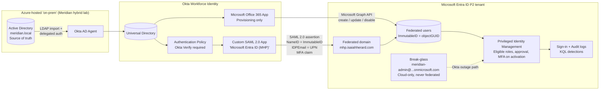
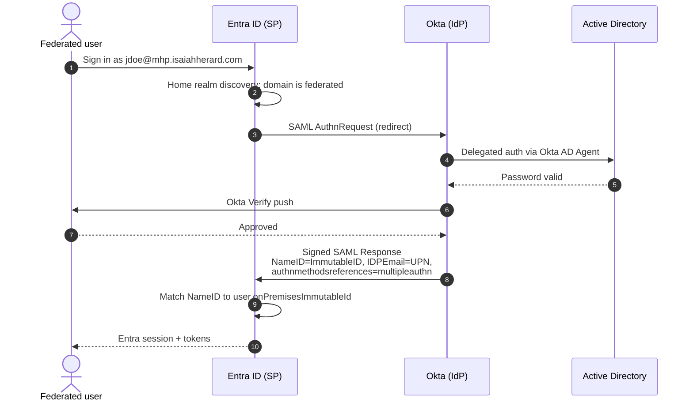
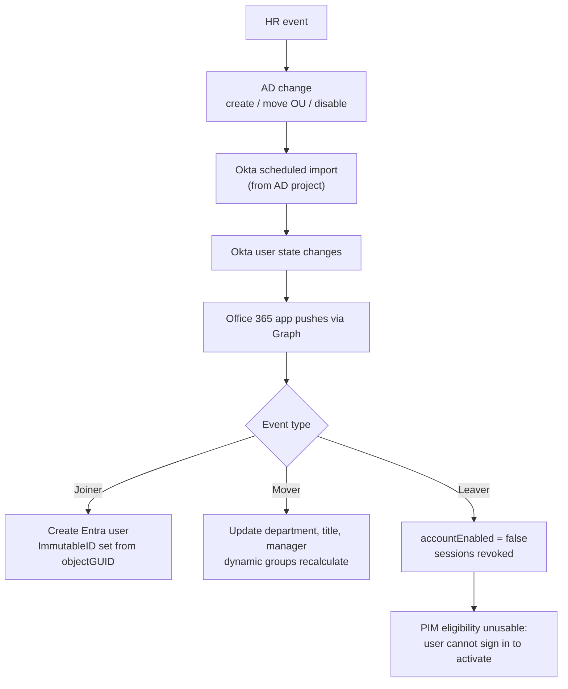

# Meridian Identity Fabric: Okta + Entra ID Federation with JIT Privileged Access

**Repo:** `meridian-okta-entra-identity-fabric`
**Org scenario:** Meridian Health Partners (MHP), ~520 employees, HIPAA / NIST SP 800-53 / ISO 27001
**Position in portfolio:** Capstone. Builds directly on the AD to Okta integration project.

---

## 1. The Problem This Solves

Most large enterprises don't run one identity platform. They run Active Directory because it has been there for 20 years, Okta because it won the SSO and SaaS war, and Entra ID because Microsoft 365 and Azure require it. The risk lives in the seams between them:

- A leaver disabled in AD still has a working Entra account because nobody connected the two.
- Admins hold standing Global Administrator rights in Entra because "it was easier."
- Authentication policy is split, so MFA strength depends on which door a user walks through.

This project wires the three directories into one chain with a single source of truth, a single authentication authority, and zero standing admin access in the cloud tenant.

**One sentence for interviews:** disable a user in AD, and within one sync cycle they lose Okta, lose Entra, and lose every PIM eligibility they held, with no manual step in between.

---

## 2. Target Architecture

### Trust boundaries

| Boundary | Direction | Protocol | What crosses it |
|---|---|---|---|
| AD to Okta | Inbound to Okta | LDAP via outbound agent | Users, groups, password checks (delegated auth) |
| Okta to Entra (identity) | Push | Microsoft Graph REST | User objects, attributes, ImmutableID, account state |
| Okta to Entra (authentication) | Browser redirect | SAML 2.0 (HTTP-POST) | Signed assertion |
| Entra to PIM | Internal | Entra role settings | Time-bound role activation |

---

## 3. Authentication Flow

---

## 4. Provisioning and Lifecycle Flow

---

## 5. Privileged Access Model (PIM)

No federated user holds a permanently active Entra role. Every admin path is eligible-only, time-bound, and logged.

| Entra role | Eligible persona | Max activation | MFA | Approval | Justification |
|---|---|---|---|---|---|
| User Administrator | IAM Analyst | 4 hrs | Yes | No | Yes |
| Security Reader | SOC Analyst | 8 hrs | Yes | No | Yes |
| Privileged Role Administrator | IAM Lead | 2 hrs | Yes | Yes (CISO) | Yes + ticket # |
| Global Administrator | IT Director | 1 hr | Yes | Yes (CISO) | Yes + ticket # |

The break-glass account is the only permanent Global Administrator. It is cloud-only, lives on the `onmicrosoft.com` domain (which can never be federated), and is excluded from every Conditional Access policy that depends on Okta.

---

## 6. Key Design Decisions

**D1. SAML federation configured through Microsoft Graph, not Okta's one-click WS-Fed.**
Okta's Office 365 app federates domains automatically, but it does so over WS-Federation. The requirement here is SAML, so federation is built by hand: a custom Okta SAML app plus an `internalDomainFederation` object in Entra with `preferredAuthenticationProtocol = saml`. Doing it manually means every claim and certificate is visible and explainable, which is the point of the project.

**D2. Provisioning uses Okta's Office 365 connector over Microsoft Graph. It is not SCIM.**
Entra ID does not expose a general SCIM endpoint that a third-party IdP can push users into. Okta's Microsoft 365 connector writes users through the Graph API instead. The README will say this plainly, because "I SCIM-provisioned into Entra" is a claim an interviewer can take apart. Entra's API-driven inbound provisioning does accept SCIM-shaped payloads, but it is built for HR sources and is out of scope.

**D3. ImmutableID is the AD objectGUID, end to end.**
The SAML NameID and the provisioned `onPremisesImmutableId` must match byte for byte or sign-in fails. Since users are AD-mastered (from the AD to Okta project), the base64 objectGUID is the anchor everywhere.

**D4. Federate a subdomain, not the root.**
`mhp.isaiahherard.com` is federated; `isaiahherard.com` is not. This limits blast radius and keeps the root domain's Cloudflare email routing untouched. Enterprises scope federation by domain the same way.

**D5. Okta owns MFA for federated users.**
Entra's `federatedIdpMfaBehavior` is set to `acceptIfMfaDoneByFederatedIdp`. The Okta app's authentication policy always requires Okta Verify, so the MFA claim in the assertion is always true. PIM's "require MFA on activation" is satisfied by Okta, so admins aren't double-prompted.

**D6. PIM eligibility is assigned to users or to cloud-native role-assignable groups only.**
Groups pushed from Okta cannot be made role-assignable after creation, so privileged group membership is managed in Entra through PIM for Groups, not pushed from Okta.

---

## 7. Build Phases

| Phase | Work | Evidence produced |
|---|---|---|
| 0. Prereqs | AD to Okta project complete; add and verify `mhp.isaiahherard.com` in Entra (TXT record in Cloudflare); confirm break-glass excluded; create cloud-only PIM approver | Verified domain, break-glass exclusion |
| 1. Okta SAML app | Custom SAML 2.0 app: SSO URL `https://login.microsoftonline.com/login.srf`, audience `urn:federation:MicrosoftOnline`, persistent NameID, IDPEmail and MFA attribute statements; Okta Verify policy | App config, attribute statements |
| 2. Federate domain | Graph PowerShell `New-MgDomainFederationConfiguration` with Okta issuer, SSO URL, signing cert, `saml`, MFA behavior | Federation config output |
| 3. Provisioning | Office 365 app (provisioning only), Graph consent granted by a PIM-activated admin, attribute mappings, ImmutableID mapping, assign MHP pilot group | Provisioned users with ImmutableID |
| 4. End-to-end SSO | Sign in as federated user, capture with SAML-tracer, decode assertion, confirm Entra sign-in log shows federated auth | SAML trace, sign-in log entry |
| 5. PIM | Role settings per table above, eligible assignments, approval flow, activation as a federated user with Okta MFA | Activation request, approval, audit log |
| 6. Lifecycle tests | Run the seeded test manifest (section 8), time each propagation | Test results table with timings |
| 7. Resilience | Simulated Okta outage, break-glass recovery, rollback runbook (domain back to managed) | Runbook, break-glass sign-in alert |
| 8. Docs | README, What Broke, Honest Wall, Medium case study, LinkedIn post | Published repo |

---

## 8. Seeded Test Manifest

Each case is planted on purpose, recorded here before the test runs, and then verified.

| ID | Scenario | Seeded condition | Expected result |
|---|---|---|---|
| T1 | Joiner | New AD user in pilot OU | Appears in Okta and Entra with correct ImmutableID; can SSO |
| T2 | Mover | Department changed in AD | Entra department updates; dynamic group membership flips |
| T3 | Leaver | AD account disabled | Okta deactivated, Entra blocked, PIM activation impossible |
| T4 | Anchor mismatch | One Entra user pre-created with a wrong ImmutableID | SSO fails with a matching error; documented fix |
| T5 | Standing privilege | One federated user given permanent Global Admin | Detected by KQL, converted to eligible |
| T6 | MFA bypass attempt | Okta policy temporarily relaxed for a test user | PIM activation blocked; logged |
| T7 | IdP outage | Okta app deactivated | Federated sign-in fails; break-glass works and fires an alert |

---

## 9. Detection Queries (Log Analytics)

- Sign-ins where `AuthenticationDetails` shows federated authentication, grouped by user
- PIM activations (`AuditLogs`, category `RoleManagement`) with requester, role, duration, justification
- Any permanent active role assignment created outside PIM
- Any break-glass sign-in (should always be zero outside test T7)

---

## 10. Honest Wall (draft)

- Okta trial is 30 days. Federation and provisioning stop working when it ends, so the build has a hard deadline and screenshots are the lasting evidence.
- Okta-to-Entra provisioning is Graph API based, not SCIM.
- A single lab tenant cannot show multi-forest or multi-tenant federation.
- No real HR system feeds AD; HR events are simulated by editing AD directly.

---

## 11. Rollback

Federation is reversible. Converting the domain back to managed authentication (`Update-MgDomain -AuthenticationType Managed` after removing the federation configuration) returns sign-in to Entra. Federated users need passwords or another sign-in method set before rollback, or they are locked out. This runbook gets written and tested in Phase 7.
