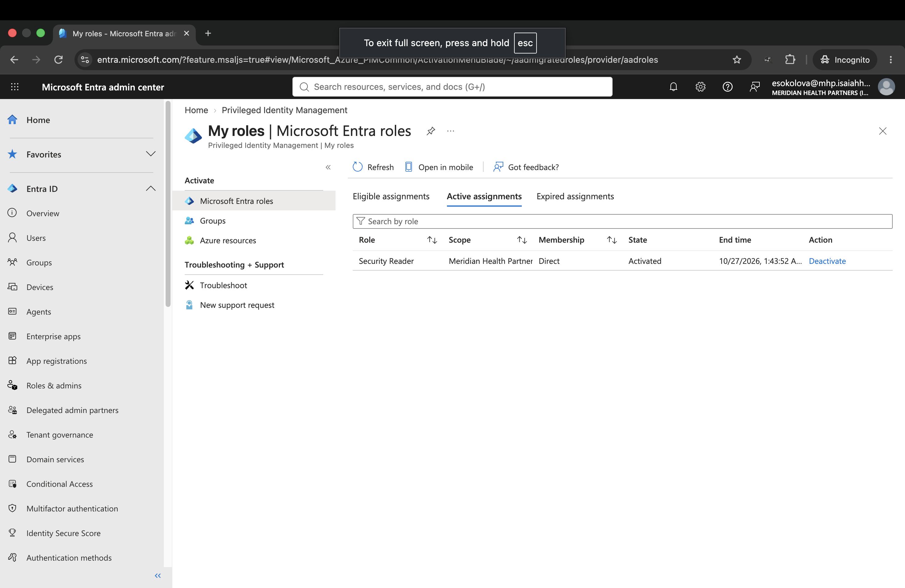
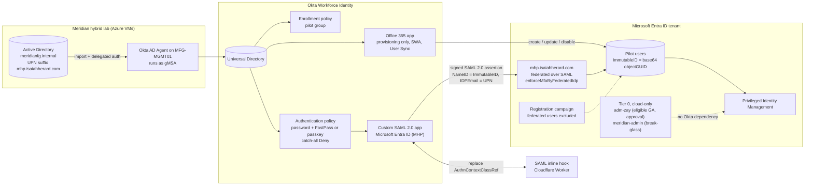
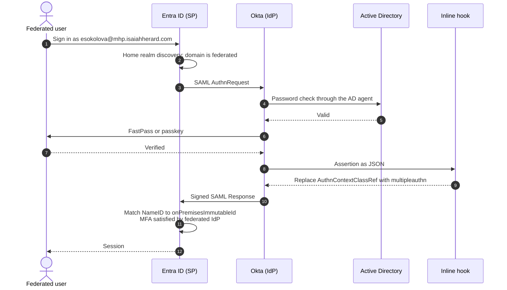
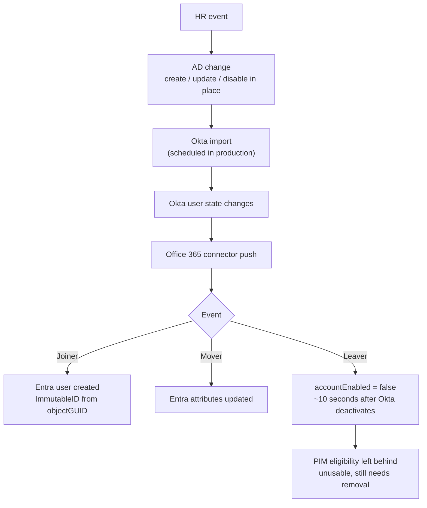
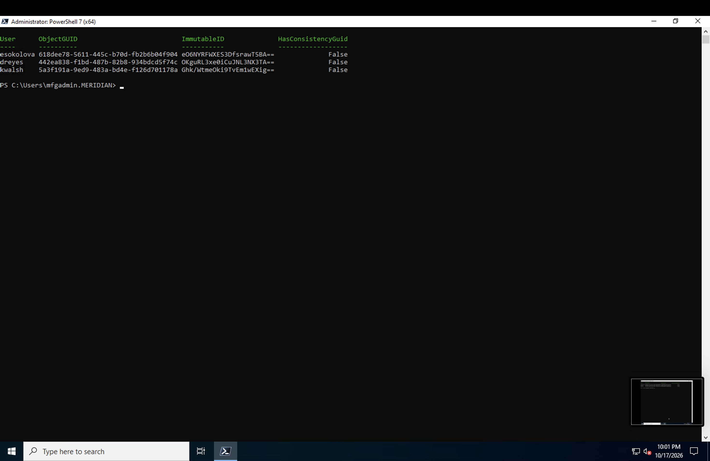
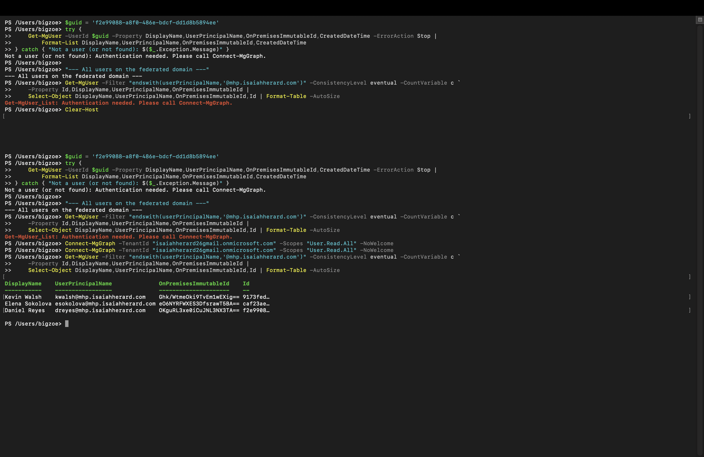
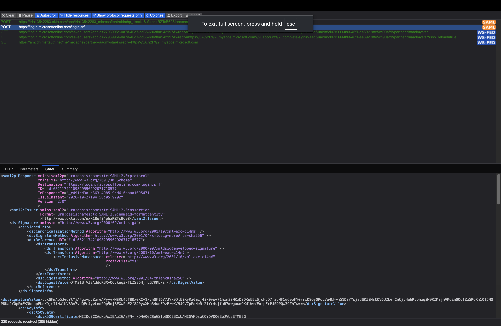

# Meridian Identity Fabric: Okta + Entra ID Federation with JIT Privileged Access


This is the capstone of my IAM/PAM portfolio. Active Directory is the source of truth, Okta is the identity provider, and Microsoft Entra ID is the service provider. A person created in AD flows into Okta and then into Entra. They sign in to Microsoft through Okta over SAML 2.0 with a phishing-resistant factor. They get admin rights in Entra only through a just-in-time PIM activation tied to a ticket. When they leave, one change in AD shuts all of it off.

I built it over two weeks in October 2026 on a live Entra tenant, a live Okta org, and a two-VM Active Directory lab in Azure. Nothing in here is a mockup. Every claim in this README points to a screenshot in `screenshots/`.

**Org scenario:** Meridian Health Partners (MHP), a fictional ~520-person regional healthcare network governed by HIPAA, NIST SP 800-53, and ISO 27001.
**Builds on:** my AD to Okta integration project (Okta AD agent with a gMSA, delegated authentication, JIT provisioning, incremental imports).

---

## Contents

1. [What this gives a company](#1-what-this-gives-a-company)
2. [What was asked for, and where it is](#2-what-was-asked-for-and-where-it-is)
3. [Results](#3-results)
4. [Architecture](#4-architecture)
5. [Lab environment](#5-lab-environment)
6. [Build walkthrough](#6-build-walkthrough)
7. [What broke and how I fixed it](#7-what-broke-and-how-i-fixed-it)
8. [Findings](#8-findings)
9. [Design decisions](#9-design-decisions)
10. [Configuration reference](#10-configuration-reference)
11. [Honest wall](#11-honest-wall)
12. [What I'd do next](#12-what-id-do-next)
13. [Repo layout](#13-repo-layout)
14. [Screenshot index](#14-screenshot-index)

---

## 1. What this gives a company

Most large companies run three identity systems at the same time. AD has been there for twenty years and still owns the employee record. Okta won SSO for the SaaS estate. Entra ID is required the moment you use Microsoft 365 or Azure. Each one works fine alone. The breaches and audit findings come from the gaps between them.

| Problem companies actually have | What this build does about it | Where it's proven |
|---|---|---|
| A terminated employee is disabled in AD but still has a working Microsoft 365 account, because nobody connected the two | One AD disable deactivates the user in Okta, and Okta disables the Entra account about 10 seconds later. No ticket to a second team. | Leaver test, screenshots 71 to 78 |
| Users get different MFA depending on which app they open, and helpdesk supports two MFA products | Okta is the only MFA authority for federated users. Entra is configured to send users back to Okta for MFA and never ask for its own. | Phase 4, screenshots 46, 56 |
| MFA that can be phished (push fatigue, SMS) | The Entra app in Okta accepts only phishing-resistant factors: Okta Verify FastPass or a FIDO2 passkey. Everything else hits a catch-all Deny. | Screenshots 21, 40h |
| Admins hold standing Global Administrator "because it was easier" | Federated users hold zero standing roles. Admin rights come from PIM: eligible only, time-boxed, MFA, justification, and a ticket number on every activation. | Phase 5, screenshots 59 to 63 |
| One person can take over the whole tenant | Global Admin requires approval from a second account before it activates | Screenshots 65 to 69 |
| An IdP compromise becomes a Microsoft compromise | Tier 0 roles never go to a federated account. Global Admin is only eligible for a cloud-only account on the `onmicrosoft.com` domain, which can never be federated. | Screenshots 64, 66, 81 |
| Nobody knows what happens when Okta goes down | Outage drill run and timed. Federated users were blocked, both admin paths still worked, recovery took 10 minutes after reactivation. Runbook written. | Phase 7, screenshots 79 to 84, `docs/rollback-runbook.md` |
| Moving from one sync tool to another creates duplicate accounts and lost history | Existing users were adopted in place with their original object IDs. Every anchor was checked against AD before and after. | Screenshots 18, 33, 35 |

### Compliance mapping

These are the controls an auditor would test against this design. The mapping is mine, based on what each control asks for.

| Control | What it asks | How this build meets it |
|---|---|---|
| NIST SP 800-53 AC-2 (Account Management) | Accounts are created, changed, and disabled through a defined process | AD is the only place a person is created or disabled. Okta and Entra follow it automatically. |
| NIST SP 800-53 AC-6 (Least Privilege) | No more access than the job needs | Federated users get Tier 1 roles only, eligible not active, 8-hour max |
| NIST SP 800-53 IA-2 (Identification and Authentication) | MFA for privileged and network access | Phishing-resistant MFA at Okta, required again at PIM activation |
| HIPAA 45 CFR 164.308(a)(3)(ii)(C) | Termination procedures that end access | One AD action ends Okta and Entra access, with timed evidence |
| HIPAA 45 CFR 164.312(d) | Verify a person is who they claim to be | Password checked against AD plus a phishing-resistant factor |
| SOX ITGC, privileged access | Elevated access is approved, time-limited, and logged | PIM audit log shows requester, approver, ticket, reason, start, and end for each activation |

---

## 2. What was asked for, and where it is

At the start of the project I set four requirements. Here's where each one ended up.

| Requirement | Delivered | Section |
|---|---|---|
| Federate Okta as the IdP into Entra ID as the SP via SAML | Domain `mhp.isaiahherard.com` federated with `preferredAuthenticationProtocol = saml`. Custom SAML 2.0 app in Okta, built by hand rather than with Okta's WS-Fed wizard. | 6.3, 6.4 |
| Provisioning from Okta into Entra ID | Okta's Microsoft 365 connector in provisioning-only mode, User Sync, create/update/deactivate. **Not SCIM.** Entra has no SCIM endpoint for third-party IdPs, and this connector writes as a directory sync client. Section 9, D2 explains. | 6.5 |
| PIM in Entra for JIT admin access | Security Reader (Tier 1) for federated users, Global Administrator (Tier 0) with approval for a cloud-only account | 6.7 |
| Document the whole build on GitHub with the full architecture diagram | This README, `ARCHITECTURE.md`, `docs/rollback-runbook.md`, the hook code, the scripts, and the screenshots | All |

---

## 3. Results

| Test | Result | Evidence |
|---|---|---|
| Federated sign-in | Elena signs in at `myapps.microsoft.com`, gets sent to Okta, passes a password check against AD and a phishing-resistant factor, and lands in Microsoft. One round trip. | 56, 57 |
| Anchor reconciliation | 3 of 3 pilot users in Entra with the ImmutableID I calculated from AD. Elena kept her original object ID. Zero duplicates. | 18, 35 |
| JIT role for a federated user | Elena activated Security Reader for 1 hour with ticket `INC0010042`. Okta's MFA satisfied PIM's MFA requirement. | 61 to 63 |
| JIT Global Admin with approval | `adm-zay` requested Global Admin with ticket `CHG0010077`. Status: Pending approval until a second account approved it. Then active for 1 hour. | 67 to 69 |
| Leaver | AD disable at **21:58:44**. Okta deactivated Daniel on import. Entra disabled his account about **10 seconds** after Okta did. His sign-in was refused at Okta. | 71 to 77 |
| Orphaned entitlement | Daniel's PIM eligibility survived the termination. Found and removed. | 76, 78 |
| IdP outage | Okta SAML app deactivated **10:11 PM**. Federated users blocked. `adm-zay` and the break-glass account signed in as Global Admin without Okta. | 79 to 82 |
| Recovery | App reactivated **10:21 PM**. Federated sign-in worked again at **10:31 PM**. | 83, 84 |



---

## 4. Architecture

### 4.1 Components



### 4.2 Sign-in flow



### 4.3 Lifecycle flow



### 4.4 Trust boundaries

| Boundary | Direction | How | What crosses it |
|---|---|---|---|
| AD to Okta | Into Okta | Outbound agent connection from MFG-MGMT01 | Users, groups, password checks |
| Okta to Entra (identity) | Push | Office 365 connector writing as a directory sync client | User objects, attributes, ImmutableID, enabled state |
| Okta to Entra (sign-in) | Browser redirect | SAML 2.0 over HTTP-POST | Signed assertion |
| Okta to inline hook | Server call | HTTPS with a shared secret in the `Authorization` header | Assertion JSON out, patch command back |
| Entra to PIM | Internal | Role settings | Time-bound role activation |

### 4.5 Who owns what

One system writes each thing. Two writers on the same object is how identity outages start.

| Object or attribute | Owner | Notes |
|---|---|---|
| The person (name, department, enabled) | Active Directory | Okta imports it |
| Okta user | Okta, sourced from AD | Changes in Okta get overwritten on the next import |
| Entra user for pilot users | Okta's Office 365 connector | `isCloudManaged` must stay `false` (D10) |
| ImmutableID | Set once on create from the AD objectGUID | Mapping applies on create only |
| Entra role assignments | Entra PIM | Never pushed by Okta |
| Tier 0 accounts | Entra, cloud-only | No sync, no federation |

---

## 5. Lab environment

| Piece | Value |
|---|---|
| Entra tenant | Meridian Health Partners, `isaiahherard26gmail.onmicrosoft.com` |
| Licensing | Enterprise Mobility + Security E5 trial (includes Entra ID P2) |
| Federated domain | `mhp.isaiahherard.com`, DNS in Cloudflare |
| Okta org | Workforce Identity trial, `trial-3542283.okta.com` |
| AD forest | `meridianfg.internal` |
| VMs | Domain controller and `MFG-MGMT01` (member server running the Okta AD agent), both in Azure, reached through Windows App |
| Okta AD agent account | `MERIDIAN\gmsa-okta$` (group managed service account, no stored password) |
| Hook host | Cloudflare Worker `okta-entra-mfa-hook` |
| Admin workstation | MacBook, PowerShell 7 with Microsoft Graph PowerShell SDK, Chrome with SAML-tracer |

### Accounts

| Account | Type | Role | Purpose |
|---|---|---|---|
| `esokolova@mhp.isaiahherard.com` (Elena Sokolova) | Federated pilot user, Risk Analyst | Eligible Security Reader | Main test user. Existing Entra object adopted in place. |
| `dreyes@mhp.isaiahherard.com` (Daniel Reyes) | Federated pilot user | Eligible Security Reader until terminated | Leaver test. Created new in Entra by Okta. |
| `kwalsh@mhp.isaiahherard.com` (Kevin Walsh) | Federated pilot user, Elena's manager | None | Created new in Entra by Okta |
| `adm-zay@isaiahherard26gmail.onmicrosoft.com` | Cloud-only Tier 0 admin | Eligible Global Administrator, approval required | Separate admin account for Tier 0 work |
| `meridian-admin@isaiahherard26gmail.onmicrosoft.com` | Cloud-only break-glass | Permanent Global Administrator | Emergencies only |
| Daily admin account | Tenant creator | Standing Global Administrator (finding F1), approver for Global Admin requests | Day-to-day lab operations |

### Groups

| Group | Where | Members | Purpose |
|---|---|---|---|
| `MHP-Entra-Federation-Pilot` | Okta | Elena, Daniel, Kevin | Assigned to both Entra apps and the enrollment policy, so account, sign-in, and MFA enrollment move together |
| `SG-Entra-Exclude-Okta-Federated` | Entra | Elena, Daniel, Kevin | Excluded from Microsoft's registration campaign, because Okta owns their MFA |

---

## 6. Build walkthrough

Each phase lists what I did, why, and the screenshots that prove it. Exact settings are in section 10. Commands are in `scripts/`.

### 6.1 Phase 0: Clean up the inherited tenant

The tenant wasn't empty. Earlier projects had left things in it, and some of them would have fought with Okta.

1. **Domain.** Made my admin account eligible for Domain Name Administrator in PIM, activated it for 1 hour, added `mhp.isaiahherard.com` in Entra, and created the TXT record in Cloudflare. Verified it and left `onmicrosoft.com` as the primary domain, because Entra won't federate the primary domain and because the cloud-only admin accounts need a domain Okta can't touch. (01 to 05)
   - Gotcha: Entra shows the TXT host as `@`, meaning the root of the domain being added. In Cloudflare's `isaiahherard.com` zone the host has to be `mhp`. Typing `@` would have put the record on the wrong domain.
2. **A sync job nobody knew was there.** Entra Connect showed **Provisioning quarantined**. That's a Cloud Sync configuration from my earlier hybrid JML project that had hit errors and paused. Quarantined isn't off. It retries, and a Restart click brings it back. If it woke up mid-project, AD and Okta would both be writing to the same users. (06)
3. **Inventory.** Filtered Entra users on "On-premises sync enabled = Yes". One result: Elena, synced by Cloud Sync, with ImmutableID `eO6NYRFWXES3DfsrawT5BA==`. (07, 08)
4. **Freeze the competing writer.** Activated Hybrid Identity Administrator and disabled the Cloud Sync configuration. Disabled, not deleted, so it's still there as evidence and as a way back. (09, 10)
5. **Move Elena's source of authority.** Used Microsoft's `onPremisesSyncBehavior` API to set `isCloudManaged = true` instead of deleting and recreating her. Her object ID, group memberships, and history stayed. Her ImmutableID didn't change. (11, 12)
   - This was half right. Section 7, item 6 explains why I reverted it in Phase 3.

### 6.2 Phase 0.5: Make the pilot users federatable

AD's real domain, `meridianfg.internal`, can't be routed on the internet, so it can never be verified or federated. Every user had a UPN on the `onmicrosoft.com` domain, which also can't be federated. So the pilot users needed a new UPN suffix.

1. **Add the suffix.** Added `mhp.isaiahherard.com` to the forest's UPN suffix list. This makes the suffix available and changes no users. (13)
2. **Build a migration manifest.** Listed every user on the old suffix: 13. Excluded 4 disabled leavers. No admin or service accounts were on the list. That left 9 active users. (14)
3. **Pick a pilot ring.** Three users from the Compliance OU, chosen so the pilot tests something:
   - Elena: an existing Entra object (the adopt-in-place path)
   - Daniel: no Entra object (the create path)
   - Kevin: Elena's manager (the manager reference has to resolve)
   The other 6 stayed on the old suffix as a control group.
4. **Move the pilot.** `Set-ADUser -WhatIf` first, then for real. Exactly 3 users on the new suffix. (15)
5. **Re-import in Okta.** Incremental import. The three usernames changed to `@mhp.isaiahherard.com` with no one editing Okta. (16, 17)
6. **Prove the anchor math.** For each pilot user, converted the AD objectGUID to base64. Elena's came out `eO6NYRFWXES3DfsrawT5BA==`, an exact match for her Entra ImmutableID. Daniel's is `OKguRL3xe0iCuJNL3NX3TA==` and Kevin's is `Ghk/WtmeOki9TvEm1wEXig==`. These are the values Okta has to send. (18, `scripts/01-compute-immutableid.ps1`)



### 6.3 Phase 1: Build the Okta SAML app

I built a custom SAML 2.0 app instead of using Okta's Office 365 integration for sign-in. Okta's integration federates over WS-Fed, and the requirement was SAML. Building it by hand also means I can explain every field in the assertion.

1. **SAML settings.** SSO URL `https://login.microsoftonline.com/login.srf`, audience `urn:federation:MicrosoftOnline`, persistent NameID. (19)
2. **NameID.** Custom application username: `hasDirectoryUser() ? findDirectoryUser().externalId : null`. When Okta imports from AD, it stores the base64 objectGUID as `externalId`. This is the same expression Okta's own provisioning connector uses for ImmutableID, so the two can't disagree.
3. **IDPEmail.** Attribute statement `IDPEmail = user.profile.login`, the user's UPN. (19b)
4. **MFA claim, first attempt.** Added an `authnmethodsreferences = multipleauthn` attribute. This turned out to be the wrong place for SAML 2.0. It caused the loop in section 7, item 11, and I removed it. (20)
5. **Authentication policy.** Created a policy just for this app: password plus a possession factor, user interaction required, re-authenticate every 2 hours, and the catch-all rule set to **Denied**. The catch-all came from Okta allowing "any 2 factor types" by default. (21, 22)
   - Phase 4 changed the allowed factors. Section 10 has the final version.
6. **Trust material.** Collected the issuer, SSO URL, and SHA-2 signing certificate (valid to Oct 2036) from the app's setup page. (23)

### 6.4 Phase 2: Federate the domain

1. **Blast radius first.** Read Okta's metadata URL in PowerShell instead of copying values by hand. Checked the domain's current state (`Managed`) and counted users on it: **0**. Federating a domain with zero users on it affects nobody. (24)
2. **Federate.** Activated Hybrid Identity Administrator and POSTed an `internalDomainFederation` object with `preferredAuthenticationProtocol = saml`. Domain went from `Managed` to `Federated`. (25, `scripts/04-federate-domain.ps1`)
3. **Sign-out.** Set `signOutUri` to Okta's sign-out URL so signing out of Microsoft also ends the Okta session.

### 6.5 Phase 3: Provisioning from Okta into Entra

1. **Pilot group.** `MHP-Entra-Federation-Pilot` in Okta with the three pilot users. Every Entra app is assigned to this group, so one membership change grants or removes everything. (26)
2. **Provisioning-only connector.** Added Okta's Microsoft Office 365 app with **SWA** as the sign-on method and the tile hidden from users. WS-Federation was never selected. Okta removes a domain's federation if an app that federated it switches methods or gets deleted, so staying off WS-Fed keeps the SAML federation untouched. Confirmed the domain still showed Federated afterward. (27, 28)
3. **Admin consent.** Authenticated the connector to Microsoft, which created the **Okta Microsoft Graph Client** in Enterprise apps. Captured the permissions it was actually granted. (29)
4. **Lifecycle settings.** User Sync, with Create, Update, and Deactivate on. Password sync off, because federated users authenticate at Okta and Entra should hold no password for them. License and role assignment off, so privilege can never come through the provisioning pipeline. (30)
5. **Anchor mapping.** Checked that ImmutableID maps from `hasDirectoryUser()?findDirectoryUser().externalId:null`, applied on **create only**. An anchor that changes on update isn't an anchor. (31)
6. **Pre-stage Elena.** Okta would look for her as `esokolova@mhp.isaiahherard.com`, not find that UPN, and try to create her with the same ImmutableID, which Entra rejects. Activated User Administrator and changed her Entra UPN to the new domain first, so Okta finds and adopts her. (32, 33)
7. **Assign and reconcile.** Assigned the pilot group. Kevin provisioned cleanly. Elena and Daniel failed for two different reasons (section 7, items 5 and 6). After the fixes, all three were in Entra with the anchors from step 6.2.6, and Elena still had her original object ID `caf23ae2-...`. (34a, 34b, 35 to 38)



### 6.6 Phase 4: First federated sign-in

Assigned the pilot group to the SAML app (39), then tried to sign in as Elena. It took five separate fixes across two sessions before one sign-in worked. All five are in section 7, items 7 to 11. The short version:

- Okta wouldn't let her in, because the policy required a factor she couldn't enroll and then a factor she couldn't use from that device. (40a to 41)
- Entra wouldn't let her finish, because it kept asking for its own MFA registration. (42 to 50)
- Then Okta and Entra bounced her back and forth 25 times, because Entra couldn't see Okta's MFA claim. (51)
- The fix for that last one was an Okta SAML inline hook running on Cloudflare Workers. (52 to 55)

After the hook, the assertion carried `AuthnContextClassRef = http://schemas.microsoft.com/claims/multipleauthn`, SAML-tracer showed one round trip, and Elena landed on My Apps. (56, 57)



### 6.7 Phase 5: PIM

1. **Licensing.** PIM was blocked. Fixed with an EMS E5 trial (section 7, item 12) and assigned licenses to every account that's PIM-eligible or approves requests. (58)
2. **Tier 1: Security Reader.** Role settings: 8-hour max activation, MFA, justification, and ticket required, no approval. Eligible assignments expire after 3 months. Permanent assignments disallowed. Direct active assignments expire after 15 days. (59)
3. **Elena eligible.** Read-only access to security posture matches a Risk Analyst who occasionally pulls evidence. (60)
4. **The headline test.** Elena, signed in through Okta, activated Security Reader for 1 hour with ticket `INC0010042`. PIM accepted Okta's MFA. The PIM audit log has the whole record. (61 to 63)
5. **Tier 0 design correction.** My original design had federated users eligible for Global Admin. That's wrong. If Okta were compromised, a federated Global Admin would hand over the Microsoft tenant. So Tier 0 got its own account. (64)
6. **Tier 0: Global Administrator.** Created `adm-zay` on the `onmicrosoft.com` domain with no roles at creation. Role settings: 2-hour max, MFA, justification, ticket, and approval from my daily account standing in for the CISO. `adm-zay` is eligible. (65, 66)
7. **Two-person rule.** `adm-zay` signed in (no Okta involved), registered Microsoft Authenticator, and requested Global Admin with ticket `CHG0010077`. The request sat at **Pending approval**. My daily account reviewed and approved it with a written justification. Global Admin was active for 1 hour. (67 to 69)
8. **Finding F1.** I chose not to remove the daily account's standing Global Admin. See section 8.

### 6.8 Phase 6: Leaver test

1. **Give Daniel something to lose.** Made him eligible for Security Reader. Captured him active in Okta and enabled in Entra. (70 to 72)
2. **Terminate.** One command on the DC: `Disable-ADAccount dreyes` at **21:58:44**. Disabled in place, inside his Compliance OU. In the AD to Okta project I found that moving a leaver out of Okta's import scope hides the change from incremental imports, so the disable happens first. (73)
3. **Okta.** Ran an incremental import. Daniel's status went to **Deactivated**. (74)
4. **Entra.** Okta's deactivation unassigned him from the connector, which disabled his Entra account **about 10 seconds later**. (75)
5. **Residue.** His PIM eligibility was still there. He can't use it, since a disabled account can't sign in, but it's an orphaned entitlement. (76)
6. **Sign-in.** Microsoft sent him to Okta, and Okta refused him. Entra's disabled account is a second wall behind that. (77)
7. **Clean up.** Removed the orphaned eligibility. (78)

### 6.9 Phase 7: Outage drill and recovery

1. **Outage.** Deactivated the Okta SAML app at **10:11 PM**. Deactivated, not deleted, so its config, certificate, assignments, and hook all survive. The provisioning app kept running. (79)
2. **Who's out.** Elena got an Okta 404 and couldn't reach Microsoft. (80)
3. **Who's still in.** `adm-zay` signed in and showed Global Administrator. The break-glass account signed in and showed Global Administrator. Neither touched Okta. (81, 82)
4. **Recovery.** Reactivated the app at **10:21 PM**. Sign-ins then failed with `Unable to find target app instance` until **10:31 PM**, when Elena got back in with no reconfiguration. (83, 84)

---

## 7. What broke and how I fixed it

Thirteen problems, in the order I hit them. For each one: what I saw, how I found the cause, the cause, the fix, and what I'd tell someone doing this at work.

### 1. Microsoft Graph kept returning 404, and device-code sign-in kept "expiring"

- **Saw:** Graph Explorer returned `404 Not Found` for Elena by UPN and by object ID. Device-code sign-in in PowerShell said the code had expired when it hadn't.
- **Diagnosed:** The Graph Explorer header said **Tenant: Personal**, and the error said `This API is not supported for MSA accounts`.
- **Cause:** My daily admin is a personal Microsoft account (Gmail-based). Both tools signed me into its personal context instead of the Meridian tenant, so Graph was searching a directory Elena isn't in.
- **Fix:** `Connect-MgGraph -TenantId "isaiahherard26gmail.onmicrosoft.com"` with a normal browser sign-in. Confirmed with `Get-MgContext` that a real TenantId came back.
- **Lesson:** Always pin the tenant. Consultants and MSP staff hit this constantly because one identity spans many tenants.

### 2. Pasting the signing certificate into Terminal ran it as commands

- **Saw:** Each line of the certificate came back as `command not found`.
- **Cause:** Multi-line paste into a shell.
- **Fix:** Read the issuer, SSO URL, and certificate from Okta's metadata URL in PowerShell. No copying at all.
- **Lesson:** Pull trust material from the IdP's metadata. It removes transcription errors and it's the same source Entra can watch for certificate rollover.

### 3. Rerunning the federation call returned 400

- **Saw:** `Domain already has Federation Configuration set`.
- **Cause:** I ran the POST twice. The first one had worked.
- **Fix:** Nothing to fix. Changes after creation use PATCH.
- **Lesson:** Entra allows one federation configuration per domain, so a repeated script can't create a second, conflicting trust.

### 4. Okta rejected `user.login` in an attribute statement

- **Saw:** `Invalid property login in expression user.login`.
- **Cause:** Okta's newer attribute statement editor uses a different expression syntax from older guides.
- **Fix:** `user.profile.login`.
- **Lesson:** Okta's admin console changes faster than the guides that describe it. The same thing happened with Provisioning settings moving to the To App page and attribute statements moving out of the app wizard.

### 5. Daniel's provisioning failed with `Request_ResourceNotFound`

- **Saw:** `Resource 'f2e99088-...' does not exist or one of its queried reference-property objects are not present.`
- **Diagnosed:** Looked up that GUID with `Get-MgUser`. It was Daniel's **new** Entra object, with the right ImmutableID.
- **Cause:** Okta created him, then made a follow-up call before Entra had finished replicating the new object.
- **Fix:** Retried only Daniel from Okta's Tasks page. (36)
- **Lesson:** Big directories are eventually consistent. The GUID in the error proved it was timing, not a mapping problem, so I didn't change any mappings. I retried only Daniel so his fix and Elena's couldn't get mixed up.

### 6. Elena's provisioning failed with "another Source of Authority"

- **Saw:** `syncOperation=Set ... sourceAnchor=eO6NYRFWXES3DfsrawT5BA== ... Unable to update an object that has another Source of Authority.` (34a)
- **Diagnosed:** The words `syncOperation` and `sourceAnchor` in the payload.
- **Cause:** Okta's User Sync doesn't write through ordinary Graph user edits. It writes through Microsoft's directory synchronization channel, the same one Entra Connect and Cloud Sync use. In Phase 0 I set Elena to `isCloudManaged = true`, which tells Entra to block writes from that channel. Entra did exactly what I told it to.
- **Fix:** Set `isCloudManaged` back to `false`. Cloud Sync was already disabled, so Okta was the only sync writer left. Retried Elena, and Okta adopted her using the same anchor. (37, 38)
- **Lesson:** The source of authority is the channel, not the product. Moving from one sync engine to another through the same channel doesn't need a cloud-managed step in between, and that step actually blocks the new engine. This is my favorite finding in the project. The SOA feature is new, and I couldn't find guidance on how it interacts with third-party sync engines.

### 7. Okta denied Elena at the username step

- **Saw:** "Unable to sign in. Contact support for assistance" before Okta even asked for a password. (40a)
- **Diagnosed:** System Log: `Access has been denied because the policy requirements could not be satisfied by the user's current set of available authenticator enrollments.`
- **Cause:** I tightened the authentication policy (what you must present) without opening an enrollment policy (what you're allowed to set up). Requirement with no path to meet it.
- **Fix:** Enrollment policy `MHP Pilot - Okta Verify enrollment`, assigned to the pilot group, Okta Verify required. (40b)
- **Lesson:** This is the classic MFA rollout lockout. Scope the enrollment policy to the same group as the requirement, so they grow together.

### 8. Still denied, even though the access testing tool said "Allowed"

- **Saw:** Same denial. Okta's Access Testing Tool said Elena was allowed and listed Okta Verify as enrolled. (40d)
- **Diagnosed:** Elena's Okta Verify was on her iPhone (40e). The rule's possession constraints had **Phishing resistant** ticked (40h).
- **Cause:** "Phishing resistant" silently excludes Push. That left FastPass as the only option, and FastPass is bound to the device it's installed on. It can't serve a browser on a different machine. The simulator doesn't model which device you sign in from, so it said yes.
- **Fix:** Kept phishing resistance and added **Passkey (FIDO2 WebAuthn)** as an allowed method. Elena already had a passkey in iCloud Keychain. (40c, 41)
- **Lesson:** FastPass vs Push is a real design choice. FastPass is phishing-resistant but needs Okta Verify on the device. Push works across devices but can be approved blindly (MFA fatigue). I kept the stronger bar and added passkeys instead of lowering it to Push.
- **Side note:** while ruling this out, I confirmed number challenge is on for all Okta Verify pushes org-wide. (40g)

### 9. Entra asked Elena to register Microsoft Authenticator

- **Saw:** After Okta signed her in, Microsoft asked her to set up Microsoft Authenticator, with no skip. (42)
- **What this told me:** Federation worked. Microsoft can't ask a user to set anything up until it has signed them in.
- **Ruled out:** ID Protection MFA registration policy (disabled, 43), security defaults (disabled because Conditional Access is in use, 44). Conditional Access policy `MHP-CA-001-RequireMFA-AllUsers` was on (45).
- **Cause (partial):** With `federatedIdpMfaBehavior = acceptIfMfaDoneByFederatedIdp`, if Entra doesn't see valid MFA from Okta, it falls back to its own MFA. Elena had no Microsoft methods, so it forced her to register one.
- **Fix:** Changed the setting to `enforceMfaByFederatedIdp`. Now if Entra needs MFA and doesn't see it, it sends the user back to Okta and never asks for Microsoft MFA. (46, `scripts/04-federate-domain.ps1`)
- **Lesson:** `enforceMfaByFederatedIdp` is the right setting when the IdP owns MFA. But this only moved the problem. See items 10 and 11.

### 10. "Let's keep your account secure," loading forever

- **Saw:** A different Microsoft interrupt, still no skip, and the page loaded indefinitely. (47)
- **Diagnosed:** Authentication methods, Registration campaign: **State: Microsoft managed, Method: Passkey (FIDO2), Include: All users, Exclude: none**. (48)
- **Cause:** A Microsoft-managed registration campaign was pushing every user, federated or not, to register a Microsoft passkey. None of my federation changes touched it. The infinite loading came from Chrome incognito blocking third-party cookies on that page.
- **Fix:** Created `SG-Entra-Exclude-Okta-Federated` with the three pilot users, set the campaign to Enabled for everyone else, and excluded the group. (49, 50)
- **Lesson:** Microsoft-managed settings can change without an admin doing anything, and this one quietly overrode my design. Keep them on for cloud-native users and exclude federated users, whose MFA belongs to the IdP.

### 11. The 25-cycle loop

- **Saw:** "We couldn't sign you in. Please try again" on `login.microsoftonline.com/login.srf`, with no error code.
- **Diagnosed:** SAML-tracer showed the browser going Okta, `login.srf`, Okta, `login.srf`, about 25 times before Microsoft gave up. (51)
- **Cause:** My mistake from Phase 1. I sent the MFA signal as an `authnmethodsreferences` **attribute**. That's how WS-Fed and SAML 1.1 carry it. For SAML 2.0, Microsoft's documentation says Entra reads inbound MFA only from `AuthnContextClassRef` inside the `AuthnStatement`, and ignores claims in the attribute section. So Okta was doing real phishing-resistant MFA and Entra couldn't see it. With `enforceMfaByFederatedIdp`, Entra sent her back to Okta for MFA, got the same assertion, and sent her back again.
- **Second obstacle:** Okta's custom SAML app only offers standard context classes in its dropdown (PasswordProtectedTransport, X.509, Kerberos, and so on). There's no way to type Microsoft's value. (52)
- **Fix:** An Okta **SAML assertion inline hook**. Okta calls an HTTPS endpoint while it builds each assertion, and the endpoint can patch it. I wrote a Cloudflare Worker ([`hook/okta-entra-mfa-hook.js`](hook/okta-entra-mfa-hook.js)) that:
  - rejects any request without the shared secret in the `Authorization` header
  - returns one `replace` operation on `/authentication/authnContext`, setting `authnContextClassRef` to `http://schemas.microsoft.com/claims/multipleauthn`
  Deployed it with the secret stored as a Worker secret (53), registered it in Okta (54), attached it to the SAML app (55), and deleted the old attribute.
- **Result:** One round trip. The assertion carries the right context class, and Elena landed on My Apps. (56, 57)
- **Safe failure:** If the hook is down or takes longer than 3 seconds, Okta sends the original assertion. Entra won't see MFA, and the sign-in fails closed. Nobody gets in without MFA.
- **Lesson:** Okta's one-click Microsoft 365 integration uses WS-Fed, which hides this difference. Building SAML 2.0 by hand surfaced it. I used the only operation Okta allows on that path (`replace`, since `add` isn't supported under `/authentication`).

### 12. PIM said I needed P2 while the Overview page said I had P2

- **Saw:** Overview: "Entra ID Premium P2". PIM Settings: "The tenant needs to have Microsoft Entra ID P2 or Microsoft Entra ID Governance license." No roles listed.
- **Diagnosed:** Microsoft 365 admin center, Licenses: P2 showed **0/1 assigned**. Your products: the subscription was **Disabled**.
- **Cause:** The plan tile shows the tenant's plan tier. PIM checks for an active, assignable license. The subscription had been disabled, and its one license was assigned to nobody.
- **Fix:** Started an Enterprise Mobility + Security E5 trial, which includes P2, and licensed the daily admin, Elena, Daniel, Kevin, and later `adm-zay`. (58)
- **Lesson:** Microsoft requires a P2 license for every user who is PIM-eligible, approves requests, or reviews access. One license makes PIM turn on, but it isn't compliant. The trial let me license everyone properly.

### 13. Recovery wasn't instant

- **Saw:** After reactivating the Okta SAML app at 10:21 PM, sign-ins failed with `Unable to find target app instance, appInstanceId=0oa18ufj4pifKmTnA698`.
- **Diagnosed:** That ID is the SAML app. Its config, assignments, and hook were all intact.
- **Cause:** Okta takes time to propagate a reactivated app.
- **Fix:** Waited. Elena got in at 10:31 PM.
- **Lesson:** Reactivation is one click, but real recovery took 10 minutes. The runbook says to test a real federated sign-in before telling users service is back.

---

## 8. Findings

| ID | Finding | Risk | Status |
|---|---|---|---|
| F1 | The tenant's original daily-use account holds standing Global Administrator | Anyone who phishes that account owns the tenant | **Accepted lab exception.** I use this account for every lab and need it to keep working. The fix is built and proven: a cloud-only Tier 0 account with eligible Global Admin, approval, ticket, and a 1-hour window. In production the standing assignment would be removed. |
| F2 | A quarantined Cloud Sync job could restart and compete with Okta for the same users | Attributes flip back and forth, users get locked out | Disabled. Config kept for rollback. |
| F3 | Disabling a user doesn't remove their PIM eligibility | Orphaned entitlements pile up and fail audits | Removed by hand. Production fix: quarterly PIM access reviews, or an Entra Lifecycle Workflow that strips eligibility when someone leaves. |
| F4 | A Microsoft-managed registration campaign overrode the federation design without any admin action | Federated users pushed into a second MFA product | Federated users excluded. Microsoft-managed settings should be reviewed in change control. |
| F5 | A break-glass sign-in alerts nobody | Misuse goes unnoticed | **Open.** Needs an alert rule (Log Analytics or Sentinel) on any `meridian-admin` sign-in. |
| F6 | Admin consent for the Okta Microsoft Graph Client was granted with the standing Global Admin from F1 | A third party's non-human identity has write access to the directory | Recorded, permissions captured (29). It belongs in regular non-human identity reviews. |

---

## 9. Design decisions

The full log with history is in [ARCHITECTURE.md](ARCHITECTURE.md). These are the ones that matter most.

| ID | Decision | Why |
|---|---|---|
| D1 | SAML federation built by hand in Okta and Graph | The requirement was SAML. Okta's wizard uses WS-Fed. |
| D2 | Okta's Office 365 connector for provisioning. Not SCIM. | Entra has no SCIM endpoint for third-party IdPs. The connector writes through Microsoft's directory sync channel, so to Entra, Okta is a sync engine. |
| D3 | ImmutableID = base64 AD objectGUID, end to end | One expression for the SAML NameID and the provisioning mapping. Set on create only. |
| D4 | Federate a subdomain | Limits blast radius and leaves root-domain email alone |
| D5 | `enforceMfaByFederatedIdp` | Okta owns MFA. Entra never asks for its own. |
| D6 | PIM eligibility on users or cloud-native groups only | Okta-pushed groups can't be role-assignable |
| D7 | Inline hook for the MFA context class | The only way to put Microsoft's value where Entra reads it for SAML 2.0 |
| D8 | Phishing-resistant factors only on the Entra app, with a catch-all Deny | The hook's MFA claim is static. This policy is what makes it true. |
| D9 | Separate apps for sign-in and provisioning | Each can be changed or disabled alone. The outage drill disabled one without the other. |
| D10 | Okta-managed users stay `isCloudManaged = false` | Otherwise Entra blocks Okta's writes |
| D11 | Leavers are disabled in place, then moved | Moving out of import scope hides the change from incremental imports |
| D12 | Tier 0 is cloud-only | An Okta compromise must not become a Microsoft compromise |

---

## 10. Configuration reference

Final settings, for rebuilding or troubleshooting.

### 10.1 Okta SAML app: Microsoft Entra ID (MHP)

| Setting | Value |
|---|---|
| Single sign-on URL | `https://login.microsoftonline.com/login.srf` (also Recipient and Destination) |
| Audience URI | `urn:federation:MicrosoftOnline` |
| Name ID format | Persistent |
| Application username | Custom: `hasDirectoryUser() ? findDirectoryUser().externalId : null` |
| Update application username on | Create and update |
| Attribute statement | `IDPEmail` = `user.profile.login` |
| Authentication context class | PasswordProtectedTransport (replaced at runtime by the hook) |
| Assertion inline hook | `Entra MFA AuthnContext (SAML 2.0)` |
| Signing certificate | SHA-2, valid to Oct 2036 |
| Assigned to | `MHP-Entra-Federation-Pilot` |

### 10.2 Okta authentication policy for the Entra app

| Setting | Value |
|---|---|
| Rule | Password / IdP + another factor |
| Possession constraints | Phishing resistant, require user interaction |
| Allowed methods | Okta Verify FastPass, Passkey (FIDO2 WebAuthn) |
| Re-authentication | Every 2 hours |
| Catch-all rule | Access denied |

### 10.3 Okta enrollment policy: MHP Pilot - Okta Verify enrollment

| Setting | Value |
|---|---|
| Assigned to | `MHP-Entra-Federation-Pilot` |
| Okta Verify | Required |
| Password | Required |
| Phone (SMS/voice) | Disabled |
| Rule | Enroll at sign-in, allowed if required authenticators are missing |

### 10.4 Okta provisioning app: Microsoft Entra ID (MHP) - Provisioning

| Setting | Value |
|---|---|
| Catalog app | Microsoft Office 365 |
| Sign-on method | SWA (never WS-Federation) |
| Tile visibility | Hidden |
| Provisioning type | User Sync |
| Create / Update / Deactivate users | On / On / On |
| Sync password | Off |
| Licenses and roles | Off |
| ImmutableID mapping | `hasDirectoryUser()?findDirectoryUser().externalId:null`, apply on create |
| Username | Okta username |
| Assigned to | `MHP-Entra-Federation-Pilot` |

### 10.5 Inline hook

| Setting | Value |
|---|---|
| Okta hook name | `Entra MFA AuthnContext (SAML 2.0)` |
| Type | SAML assertion |
| Endpoint | Cloudflare Worker `okta-entra-mfa-hook` |
| Authentication | Header `Authorization`, shared secret (stored in Bitwarden and as the Worker secret `HOOK_SECRET`) |
| Patch | `replace /authentication/authnContext` with `authnContextClassRef = http://schemas.microsoft.com/claims/multipleauthn` |

### 10.6 Entra domain federation: mhp.isaiahherard.com

| Setting | Value |
|---|---|
| displayName | `Okta - MHP (SAML)` |
| issuerUri | `http://www.okta.com/exk18ufj4phzRZTcB698` |
| passiveSignInUri | `https://trial-3542283.okta.com/app/trial-3542283_microsoftentraidmhp_1/exk18ufj4phzRZTcB698/sso/saml` |
| signOutUri | `https://trial-3542283.okta.com/login/signout` |
| preferredAuthenticationProtocol | `saml` |
| federatedIdpMfaBehavior | `enforceMfaByFederatedIdp` (was `acceptIfMfaDoneByFederatedIdp`) |
| isSignedAuthenticationRequestRequired | `false` |

### 10.7 Entra PIM role settings

| Setting | Security Reader (Tier 1) | Global Administrator (Tier 0) |
|---|---|---|
| Max activation | 8 hours | 2 hours |
| MFA on activation | Yes | Yes |
| Justification | Yes | Yes |
| Ticket information | Yes | Yes |
| Approval | No | Yes, by the daily admin account |
| Permanent eligible | Not allowed | Not allowed |
| Eligible assignments expire | 3 months | 3 months |
| Permanent active | Not allowed | Not allowed |
| Active assignments expire | 15 days | 15 days |
| Eligible members | Elena | `adm-zay` |

### 10.8 Other Entra settings

| Setting | Value |
|---|---|
| Registration campaign | Enabled, Passkey (FIDO2), all users, excluding `SG-Entra-Exclude-Okta-Federated` |
| Cloud Sync configuration for `meridianfg.internal` | Disabled (not deleted) |
| Security defaults | Disabled (Conditional Access in use) |
| `MHP-CA-001-RequireMFA-AllUsers` | On |

---

## 11. Honest wall

- **The Okta trial runs 30 days.** Federation and provisioning stop when it ends. The screenshots are the lasting evidence.
- **Separation of duties is simulated.** I control both the account that requests Global Admin and the account that approves it. In production the approver is a different person.
- **The MFA claim is static.** The hook stamps every assertion `multipleauthn`. That's true only because the app policy requires a phishing-resistant factor and ends in a catch-all Deny. Loosen the policy and the claim lies to Entra.
- **"About 10 seconds" is the Okta to Entra leg.** I ran the AD to Okta import by hand. In production that leg runs on the import schedule, so the real cutoff is the import interval plus about 10 seconds. For high-risk terminations, trigger an import on demand.
- **Provisioning is not SCIM.** Saying "SCIM-provisioned into Entra" about this build would be wrong.
- **The pilot group lives in Okta.** In production it would be mastered in AD so HR-driven changes control it.
- **Tests I didn't run:** joiner, mover, KQL detection of standing privilege, and the MFA-bypass test. The anchor-mismatch case happened for real in Phase 3, so I didn't stage it.
- **Rollback is documented, not executed.** The runbook flags one step I haven't tested.
- **F1 is still open** by choice, as explained in section 8.

---

## 12. What I'd do next

1. Alert on every break-glass sign-in (F5).
2. Quarterly PIM access review on Security Reader and Global Administrator, so orphaned eligibility can't survive a quarter (F3).
3. Run the joiner and mover tests and time them.
4. Master the pilot group in AD.
5. Replace the static MFA claim with one the hook derives from Okta's actual authentication context, so a policy change can't make it false.
6. Test the rollback runbook in a maintenance window, starting with the cloud password reset question in section B2.

---

## 13. Repo layout

```
.
├── README.md                     this file
├── ARCHITECTURE.md               design, diagrams, full decision log
├── LICENSE
├── docs/
│   └── rollback-runbook.md       Okta outage response and federation rollback
├── hook/
│   └── okta-entra-mfa-hook.js    Cloudflare Worker for the Okta SAML inline hook
├── scripts/
│   ├── 01-compute-immutableid.ps1
│   ├── 02-ad-upn-pilot-migration.ps1
│   ├── 03-set-source-of-authority.ps1
│   ├── 04-federate-domain.ps1
│   ├── 05-verify-pilot-anchors.ps1
│   └── 06-leaver-disable.ps1
└── screenshots/                  evidence, numbered in build order
```

---

## 14. Screenshot index

| # | File | Shows |
|---|---|---|
| 01 | `01-pim-domain-name-admin-eligible-assignment.png` | Domain Name Administrator made eligible |
| 02 | `02-pim-domain-name-admin-activated.png` | Activated for 1 hour |
| 03 | `03-entra-custom-domain-pending-txt-record.png` | Subdomain added, TXT record pending |
| 04 | `04-cloudflare-txt-record-mhp-subdomain.png` | TXT record at host `mhp` |
| 05 | `05-entra-domain-verified-not-primary.png` | Verified, not primary |
| 06 | `06-entra-connect-sync-status.png` | Cloud Sync quarantined |
| 07 | `07-entra-elena-source-of-authority.png` | Elena synced, anchor present |
| 08 | `08-entra-synced-users-inventory.png` | One synced user |
| 09 | `09-pim-hybrid-identity-admin-activated.png` | Hybrid Identity Administrator active |
| 10 | `10-cloud-sync-config-disabled.png` | Cloud Sync disabled |
| 11 | `11-elena-soa-before-ad-managed.png` | `isCloudManaged = false` |
| 12 | `12-elena-soa-after-cloud-managed-anchor-preserved.png` | `isCloudManaged = true`, anchor unchanged |
| 13 | `13-ad-upn-suffix-added.png` | Forest UPN suffix added |
| 14 | `14-ad-upn-migration-manifest.png` | 13 users on the old suffix |
| 15 | `15-ad-pilot-upn-migrated.png` | 3 pilot users moved |
| 16 | `16-okta-system-log-import-upn-updates.png` | Okta import picked up the change |
| 17 | `17-okta-pilot-usernames-federated-suffix.png` | Okta usernames updated |
| 18 | `18-ad-objectguid-to-immutableid-proof.png` | objectGUID to base64 matches Entra |
| 19 | `19-okta-saml-app-settings.png` | SAML app settings |
| 19b | `19b-okta-saml-app-idpemail-attribute.png` | IDPEmail attribute |
| 20 | `20-okta-saml-app-mfa-claim.png` | MFA as an attribute (the approach that failed, see 7.11) |
| 21 | `21-okta-auth-policy-rules.png` | App policy with catch-all Deny |
| 22 | `22-okta-entra-app-auth-policy-attached.png` | Policy attached to the app |
| 23 | `23-okta-idp-metadata-values.png` | Issuer and SSO URL |
| 24 | `24-entra-domain-before-federation-blast-radius.png` | Managed, 0 users on the domain |
| 25 | `25-entra-domain-federated-saml-okta.png` | Federated over SAML |
| 26 | `26-okta-pilot-group-members.png` | Pilot group |
| 27 | `27-okta-o365-app-swa-not-wsfed.png` | Connector on SWA |
| 28 | `28-entra-domain-still-federated-after-o365-app.png` | Federation untouched |
| 29 | `29-entra-okta-connector-granted-permissions.png` | Okta Graph client permissions |
| 30 | `30-okta-o365-provisioning-user-sync-enabled.png` | User Sync, lifecycle actions |
| 31 | `31-okta-o365-mappings-immutableid.png` | ImmutableID mapping, create only |
| 32 | `32-pim-user-admin-activated.png` | User Administrator active |
| 33 | `33-entra-elena-upn-prestaged-federated-domain.png` | Elena pre-staged |
| 34a | `34a-okta-elena-provision-fail-soa-blocked.png` | SOA error |
| 34b | `34b-okta-daniel-provision-fail.png` | Replication timing error |
| 35 | `35-entra-pilot-users-anchors-reconciled.png` | All anchors match |
| 36 | `36-okta-daniel-retry-success.png` | Daniel retry |
| 37 | `37-elena-soa-reverted-sync-managed.png` | `isCloudManaged` back to `false` |
| 38 | `38-okta-elena-provisioning-success.png` | All three provisioned |
| 39 | `39-okta-saml-app-pilot-group-assigned.png` | SAML app assigned |
| 40a | `40a-okta-system-log-sign-on-denied.png` | Denial reason |
| 40b | `40b-okta-enrollment-policy-pilot-okta-verify.png` | Enrollment policy |
| 40c | `40c-okta-auth-rule-allowed-methods.png` | Allowed methods |
| 40d | `40d-okta-access-testing-tool-elena.png` | Simulator says allowed |
| 40e | `40e-okta-elena-existing-authenticators.png` | Okta Verify on iPhone |
| 40f | `40f-okta-elena-saml-nameid-matches-anchor.png` | Okta app username = anchor |
| 40g | `40g-okta-verify-push-number-challenge.png` | Push and number challenge on |
| 40h | `40h-okta-rule-possession-constraints.png` | Phishing resistant ticked |
| 41 | `41-okta-security-methods-setup-elena.png` | Elena enrolling |
| 42 | `42-entra-accepted-assertion-authenticator-prompt.png` | Entra signed her in, then asked for Authenticator |
| 43 | `43-entra-idp-mfa-registration-policy-disabled.png` | ID Protection policy ruled out |
| 44 | `44-entra-security-defaults-status.png` | Security defaults ruled out |
| 45 | `45-entra-conditional-access-policies.png` | CA policies |
| 46 | `46-entra-federation-mfa-enforce-by-okta.png` | `enforceMfaByFederatedIdp` |
| 47 | `47-entra-registration-interrupt-after-enforce.png` | Registration interrupt |
| 48 | `48-entra-registration-campaign-before.png` | Campaign targeting all users |
| 49 | `49-entra-exclude-group-members.png` | Exclusion group |
| 50 | `50-entra-registration-campaign-federated-excluded.png` | Campaign with exclusion |
| 51 | `51-saml-tracer-mfa-loop.png` | The 25-cycle loop |
| 52 | `52-okta-context-class-no-custom-option.png` | No custom context class in Okta |
| 53 | `53-cloudflare-worker-hook-deployed.png` | Worker deployed |
| 54 | `54-okta-inline-hook-registered.png` | Hook registered in Okta |
| 55 | `55-okta-saml-app-inline-hook-attached.png` | Hook attached to the SAML app |
| 56 | `56-saml-tracer-assertion-authncontext-multipleauthn.png` | Fixed assertion, one round trip |
| 57 | `57-elena-signed-in-myapps.png` | First federated sign-in |
| 58 | `58-m365-ems-e5-licenses-assigned.png` | Licenses assigned |
| 59 | `59-pim-security-reader-role-settings.png` | Tier 1 role settings |
| 60 | `60-pim-elena-eligible-security-reader.png` | Elena eligible |
| 61 | `61-pim-elena-activation-request.png` | Activation request |
| 62 | `62-pim-elena-security-reader-active.png` | Active, time-boxed |
| 63 | `63-pim-audit-elena-activation.png` | Audit record |
| 64 | `64-entra-tier0-cloud-only-admin.png` | Cloud-only Tier 0 account |
| 65 | `65-pim-global-admin-role-settings-approval.png` | Tier 0 settings with approval |
| 66 | `66-pim-adm-zay-eligible-global-admin.png` | `adm-zay` eligible |
| 67 | `67-pim-adm-zay-global-admin-pending-approval.png` | Pending approval |
| 68 | `68-pim-audit-global-admin-approval.png` | Approval in the audit log |
| 69 | `69-pim-adm-zay-global-admin-active.png` | Global Admin active for 1 hour |
| 70 | `70-pim-daniel-eligible-security-reader.png` | Daniel eligible |
| 71 | `71-before-okta-daniel-active.png` | Before: Okta active |
| 72 | `72-before-entra-daniel-enabled.png` | Before: Entra enabled |
| 73 | `73-ad-daniel-disabled.png` | AD disable at 21:58:44 |
| 74 | `74-okta-daniel-deactivated.png` | Okta deactivated |
| 75 | `75-after-entra-daniel-disabled.png` | Entra disabled |
| 76 | `76-pim-daniel-orphaned-eligibility.png` | Orphaned eligibility |
| 77 | `77-daniel-signin-blocked.png` | Sign-in refused at Okta |
| 78 | `78-pim-daniel-orphaned-eligibility-removed.png` | Eligibility removed |
| 79 | `79-okta-saml-app-deactivated-outage.png` | Outage starts |
| 80 | `80-outage-elena-blocked-at-okta.png` | Federated user blocked |
| 81 | `81-outage-adm-zay-signed-in.png` | Tier 0 admin still in |
| 82 | `82-outage-break-glass-signed-in.png` | Break-glass still in |
| 83 | `83-okta-saml-app-reactivated.png` | App reactivated |
| 84 | `84-recovery-elena-signed-in.png` | Federated sign-in restored |

---

## License

MIT
